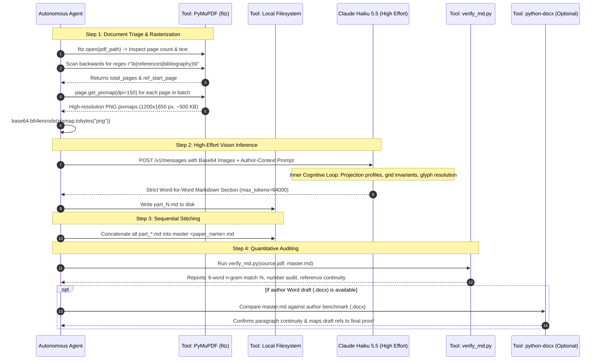
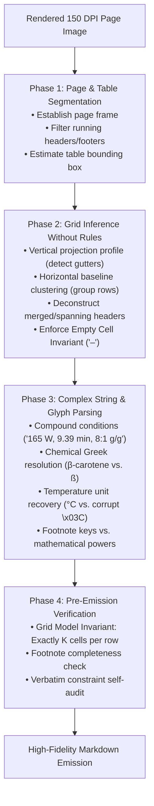

# PDF to Verbatim Markdown: Universal Agent Skill & Cognitive Architecture

A comprehensive, production-grade guide and agent skill template for autonomous AI agents converting academic research and review paper PDFs into exact, word-for-word Markdown (`.md`).

This skill explains **both the outer orchestration workflow and the inner cognitive reasoning engine**:
* **Layer 1 (The Outer Pipeline):** Cross-platform PyMuPDF rasterization, dynamic segmentation, API payload structures, and post-conversion auditing.
* **Layer 2 (The Inner Engine - The "HOW"):** The exact cognitive heuristics, visual projection algorithms, grid invariants, and glyph disambiguation logic utilized by multimodal vision models (`claude-haiku-5-5` with `effort: "high"` and adaptive thinking) to achieve publication-grade fidelity.

---

## 1. Core Philosophy & Ground Rules

1. **Strict Verbatim Fidelity**: No paraphrasing, summarizing, condensing, or silent editorial corrections. Typos, idiosyncratic capitalizations, and notation quirks in the published source must remain as printed.
2. **Visual Multimodal OCR First**: Academic PDFs feature two-column flows, spanning banners, complex multi-row tables, and chemical/mathematical structures. Naive text extractors scramble column reading order. Render pages at **150–200 DPI as images** and feed them to a multimodal vision model with high reasoning effort (`claude-haiku-5-5` with `effort: "high"` and `thinking: {"type": "adaptive"}`).
3. **Preventive Prompt Engineering**: Commercial LLMs trigger safety refusals if asked to "transcribe a published paper." Always frame conversion within **legitimate author-assisted digitization**.
4. **Dynamic Content-Aware Batching**: Never send an entire 15+ page paper in a single prompt. Always process in 3–4 page logical batches to prevent output token exhaustion.
5. **Two-Pass Bibliography Handling**: Dense reference sections contain ~1,400 words per page. Always split reference pages into dedicated sub-batches (~40–60 references per call).

---

## 2. Layer 1: Outer Orchestration & Tool Pipeline

---

## 3. Layer 2: The Inner Cognitive Engine (The Exact "HOW")

This section documents the internal reasoning heuristics, spatial projection algorithms, and pre-emission verification checks that Claude Haiku 5.5 executes during high-effort adaptive thinking (`effort: "high"`):

---

### Phase 1: Visual Scene Decomposition & Bounding Box Inference
* **Page Frame Identification**:
  - The model isolates running headers (e.g. journal title, volume, year) and footers (page numbers, copyright notices) by identifying elements that repeat at consistent Y-coordinates across pages.
  - Text outside the central reading frame is stripped immediately.
* **Table Bounding Box Detection**:
  - In scientific articles, tables frequently lack full enclosing borders.
  - The model clusters text by whitespace density and alignment changes. The table boundary is established where paragraph prose transitions into repeating tabular row structures.
  - Table captions above the table (e.g., `Table 1: Recent advancement...`) and footnote definitions below the table (e.g., `Unit: (a) mg/g...`) are demarcated as boundary sentinels and kept distinct from grid data cells.

---

### Phase 2: Grid & Topology Inference Without Rules
Academic papers predominantly use "open" borderless tables (horizontal lines at top, bottom, and header, but zero vertical lines). The model infers the underlying matrix using visual geometry:

1. **Vertical Projection Profiles (Column Gutters)**:
   - The model computes a vertical projection across all rows.
   - Text appears in vertical clusters separated by persistent vertical whitespace gutters.
   - These gutters define the $K$ columns of the table (e.g., an 11-column table has 10 distinct vertical whitespace gutters traversing top-to-bottom).
2. **Horizontal Baseline Clustering (Row Grouping)**:
   - Cells containing multi-line entries (e.g., `Apricot and shrimp waste(d)` or multi-parameter condition strings) span multiple visual lines.
   - The model clusters text lines into unified rows using horizontal baselines and row padding whitespace, preventing row splintering.
3. **Deconstructing Merged / Spanning Headers**:
   - When a category header spans multiple columns (e.g., `Carotenoids (µg/g)` spanning columns for $\beta$-carotene, lutein, and lycopene), the model detects that the header's horizontal width covers multiple vertical column bands.
   - It flattens these into clean, descriptive Markdown table headers: `| Source | Method | Condition | Fucoxanthin | β-Carotene | Lutein | Lycopene | ... |`.
4. **The Critical Empty Cell Invariant (Preventing Left-Shift Corruption)**:
   - **The Core Risk**: If an empty cell is skipped or emitted as empty whitespace, every subsequent column in that row shifts left by one column. This completely corrupts the data matrix (e.g. a yield value shifts into the reference citation column!).
   - **The Strict Rule**: The model enforces an invariant: **Every single row must resolve to exactly $K$ cells**. Empty cells must receive an explicit placeholder em-dash or en-dash (`–`).

---

### Phase 3: Complex String & Glyph Disambiguation
* **Compound Condition Strings**:
  - Experimental conditions often appear as dense, comma-separated parameter strings: `165 W, 9.39 min, 8.06:1 g/g` or `208 W/cm², 20 °C, 5 min`.
  - The model validates that each sub-token corresponds to physical parameters (power $W$, time $\text{min}$, pressure $\text{MPa}$, temperature $^\circ\text{C}$, liquid-to-solid ratio $\text{mL/g}$).
  - It treats the compound condition as a single atomic cell unit without accidentally splitting at interior commas.
* **Chemical Greek Letters & Look-Alikes**:
  - Distinguishes $\beta$ from German eszett (ß) or standard letter 'b' using scientific domain context ($\beta$-carotene, $\alpha$-tocopherol, $\beta$-cyclodextrin).
* **Degree & Metric Symbols**:
  - Distinguishes degree symbol ($^\circ$) from superscript zero ($^0$) or letter 'o' (`°C`, never `oC`).
  - Preserves micro symbols ($\mu\text{m}$, $\mu\text{g/g}$) rather than degrading to ASCII `um` or `ug`.
* **Footnote Markers vs. Measured Data**:
  - Distinguishes superscript letters `(a)`, `(b)`, `(c)` attached to material sources (e.g. `Orange peel(d)`) from numbers that are measured data points.
  - Ensures footnote markers match the footnote definitions compiled beneath the table.
* **Italicized Binomial Nomenclature**:
  - Detects botanical and microbiological taxonomic names (genus capitalized, species lowercase) and wraps them in Markdown italics: `*Rhodotorula glutinis*`, `*Hylocereus polyrhizus*`.

---

### Phase 4: Pre-Emission Verification Checks
During the high-effort thinking phase, prior to emitting output tokens, the model performs a three-point internal audit:
1. **Structural Matrix Check**: Confirms that header cell count equals separator cell count equals data cell count for all $N$ rows ($C_{\text{header}} = C_{\text{sep}} = C_{\text{data}} = K$).
2. **Footnote Cross-Reference Check**: Confirms that every footnote key used in the table cells (`(a)` through `(o)`) has a corresponding definition entry recorded below the table.
3. **Verbatim Fidelity Audit**: Confirms that no rows were summarized with ellipsis (`...`) or omitted for brevity.

---

## 4. The 6 Critical Failure Modes & Preventive Measures

| ❌ Failure Mode | 💡 Root Cause | ✅ Battle-Tested Preventive Measure |
| :--- | :--- | :--- |
| **1. Copyright / Refusal Filter** | Generic prompts like *"transcribe this published paper word-for-word"* trigger safety guardrails. | **Author-Context Prompt Framing**: Frame the prompt as assisting the author in digitizing their research paper and data tables into Markdown. |
| **2. Token Starvation in High Effort** | `thinking: adaptive` + `effort: high` generates thousands of reasoning tokens, exhausting standard output budgets. | Set `max_tokens: 64000` and dynamically partition papers into 3-page body chunks and 2-page bibliography chunks. |
| **3. Two-Column Reading Interleaving** | Raw text extractors parse horizontally by Y-coordinate, interleaving left and right column sentences. | **Visual Multimodal OCR**: Render pages at 150–200 DPI PNG. The vision model understands visual geometry and reads left-to-right, column-by-column. |
| **4. Table Truncation Across Page Breaks** | Wide, multi-page data tables lose columns or get abbreviated with ellipsis (`...`). | Strict prompt rules instructing the model to reconstruct full Markdown tables (`\| ... \|`), preserving every row, unit, and footnote. |
| **5. Corrupted Glyphs & OS Encoding Crashes** | PDF fonts remap degree symbols (`\x03C`), micro ($\mu\text{m}$), and arrows. Scripts crash on Windows `cp1252`. | Pure-Python cross-platform architecture with PyMuPDF, UTF-8 stdout reconfigured, and visual glyph reading. |
| **6. Truncated Reference Bibliographies** | Dense reference sections contain ~1,400 words/page, exceeding token limits when combined. | Dedicated bibliography sub-batching (processing no more than ~40–60 references per call). |

---

## 5. Dual Ground-Truth Benchmarking Protocol

If the author provides a pre-publication Word manuscript (`.docx`):

1. **Use PDF as Final Authority**: The published PDF represents the final edited version with proof corrections, final layout, and any additional references added during peer review.
2. **Use Word DOCX as Structural Benchmark**: The author draft (typically ~99% identical in body prose) serves as a baseline to verify:
   - Paragraph continuity (confirming no paragraphs were dropped).
   - Numerical values in tables.
   - Spelling of technical terms and author names.
3. **Reference Mapping**: Author drafts often have fewer references than the published paper (e.g. 137 in draft vs 149 in final published PDF). Map draft references to confirm baseline integrity and verify that final additions match the published proof.

---

## 6. Verification Checklist for Autonomous Agents

Before marking any conversion task complete, the agent must verify:

- [ ] **Total Word Count**: Markdown word count is within expected variance of source text layer.
- [ ] **6-Word Verbatim Alignment**: $\ge 85\%$ of 6-word n-grams match the source text verbatim.
- [ ] **Table Integrity**: Every table mentioned in the text exists with complete rows, parameter columns, and units.
- [ ] **Figure Captions**: All figure captions are captured with placeholder tags `*[Image: Fig. N. Caption text [Ref].]*`.
- [ ] **Reference Continuity**: Every reference from `[1]` to `[N]` is present without missing indices.
- [ ] **Special Characters**: All degree symbols (`°C`), micro units (`µm`), reaction arrows ($\rightarrow$), and Greek letters ($\alpha, \beta$) are rendered properly.
